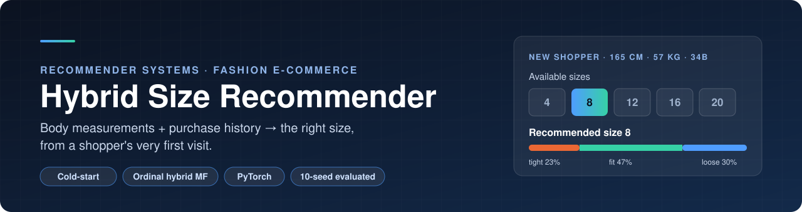
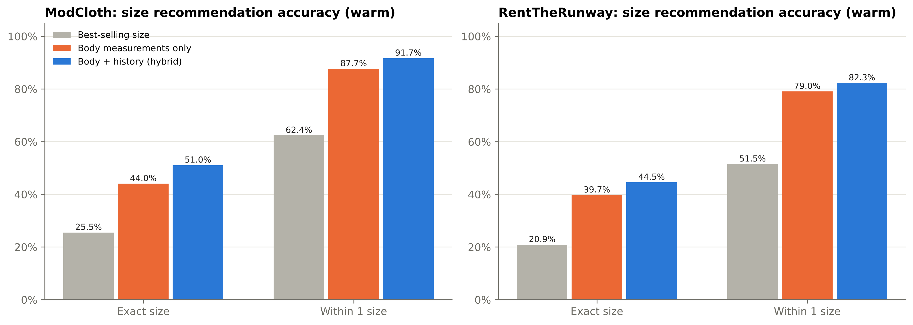
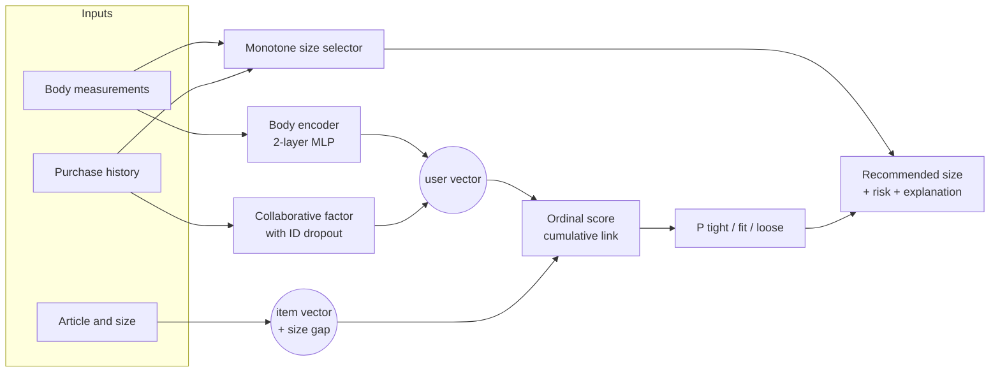
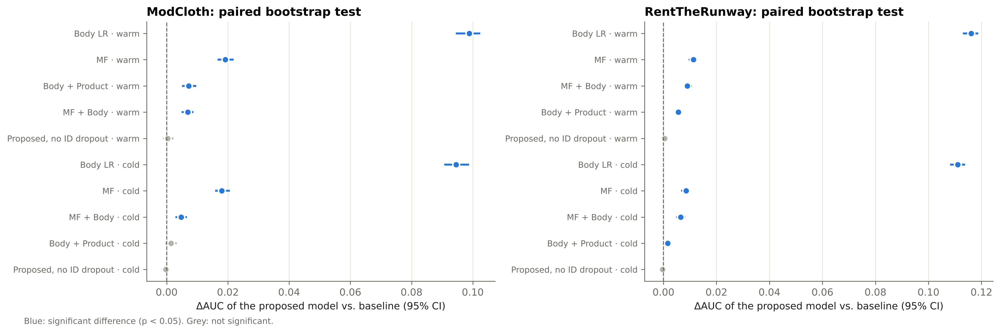

<p align="center">
  
</p>

<p align="center">
  <a href="https://github.com/ngminhthotech/hybrid-size-recommender/actions/workflows/ci.yml"></a>
  
  
  <a href="LICENSE"></a>
  <a href="paper/sizerec-paper.pdf"></a>
  <a href="notebooks/sizerec_demo.ipynb"></a>
</p>

<p align="center">
  <b>A hybrid ordinal matrix-factorization model and CLI that recommends apparel sizes for new and returning shoppers.</b><br>
  <a href="paper/sizerec-paper.pdf">Paper</a> ·
  <a href="notebooks/sizerec_demo.ipynb">Notebook</a> ·
  <a href="results/">Results</a> ·
  <a href="README.vi.md">Tiếng Việt</a>
</p>

---

## Table of contents

- [Overview](#overview)
- [Key results](#key-results)
- [Architecture](#architecture)
- [Getting started](#getting-started)
- [Usage](#usage)
- [Reproducing the experiments](#reproducing-the-experiments)
- [Benchmarks](#benchmarks)
- [Project structure](#project-structure)
- [Tech stack](#tech-stack)
- [Roadmap](#roadmap)
- [Citation](#citation)
- [Authors](#authors)
- [License](#license)

## Overview

Wrong size is the leading cause of returns in online fashion. Size labels are not standardised across brands, and many brands label garments smaller than they are, a practice known as *size vanity*. Collaborative filtering can learn a shopper's habits, but **about two thirds of shoppers in public fit datasets have a single purchase**, and a new shopper has none.

`sizerec` addresses this cold-start problem with three ideas:

- **Body measurements inside the user vector.** Self-reported measurements are projected into the same latent space as the collaborative factor, so one model relies on the body when there is no history and learns personal preferences once there is.
- **Ordinal fit model with product context.** Category, occasion, standardised size and a size-gap feature predict P(tight), P(fit) and P(loose) for any shopper–article–size triple.
- **Monotone, explainable size selection.** The concrete size comes from an interpretable monotone model that avoids the selection bias of observational fit data; the fit model then reports the risk and explains the decision.

## Key results

Evaluated on **ModCloth** (82,790 transactions) and **RentTheRunway** (192,544 transactions), with 10 repetitions and paired significance tests.

| Metric | ModCloth | RentTheRunway |
| --- | :---: | :---: |
| Exact size match, best-selling size → **sizerec** | 25.5% → **51.0%** | 20.9% → **44.5%** |
| Within one size, **sizerec** | **91.7%** | **82.3%** |
| Cold-start AUC, plain MF → **sizerec** | 0.661 → **0.679** | 0.722 → **0.731** |
| Gain over body + product model, users with 2–4 purchases | **+0.015 AUC** | **+0.007 AUC** |

<p align="center">
  
</p>

## Architecture



| Component | Role |
| --- | --- |
| `u = m_u · p_u + E(x_u)` | Collaborative factor for known users plus a projection of body measurements |
| `v = q_(i,s) + q_i + c_cat + c_ctx + z_s·w + gap·w_gap` | Article–size, article, category, context, size and size-gap embeddings |
| `P(y ≤ k) = σ(θ_k − t)` | Ordinal head over tight < fit < loose |
| ID dropout (10%) | Trains the body branch to work on its own, so one model serves everyone |
| Size selector | `target = blend(history, body; k = 2) + category offset + article offset` |

## Getting started

**Requirements:** Python 3.9+, about 1 GB of disk for the CPU build of PyTorch. A GPU is not needed.

```bash
git clone https://github.com/ngminhthotech/hybrid-size-recommender.git
cd hybrid-size-recommender
python -m venv .venv && source .venv/bin/activate   # Windows: .venv\Scripts\activate
pip install -r requirements.txt
pip install -e .
```

## Usage

Recommend a size for a brand-new shopper with a pre-trained model:

```bash
sizerec recommend results/models/rtr.pt --item 126335 \
  --height 165cm --weight 57kg --bust-size 34b --body-type petite --age 22 --explain
```

```text
Recommended size: 8   P(fit) 47.2%   P(tight) 23.3%   P(loose) 29.5%
Target size 7.10 = body-based size 6.23 + dress category 0.28 + article runs small 0.59
```

<sub>The CLI prints in Vietnamese; output translated above.</sub>

| Command | Description |
| --- | --- |
| `sizerec` | Interactive menu |
| `sizerec data <file>` | Dataset statistics |
| `sizerec experiment <file> --quick` | One-seed sanity run (about 30 s) |
| `sizerec experiment <file> --seeds 1 … 10` | Full benchmark with significance tests |
| `sizerec train <file> -o model.pt` | Train the proposed model on all data |
| `sizerec recommend model.pt … --json` | Machine-readable output for integration |

## Reproducing the experiments

```bash
bash scripts/run_all.sh        # Linux / macOS / Git Bash
scripts\run_all.bat            # Windows
```

The script reruns dataset statistics, the smoke test, the full benchmark (7 models × 2 protocols × 10 seeds), model training, recommendation examples, every figure and the summary spreadsheet. It takes about 20–40 minutes on a 4-core CPU.

**Protocol.** *Cold-start*: users split 80/10/10, so every test user is new. *Warm*: transactions split 80/10/10 at random, following Misra et al. (2018) and SFNet, with results broken down by purchase history.
**Leakage control.** Encoders, ID maps, the size regressor and article offsets are fitted on each training split only; post-purchase fields are dropped; validation is used only for early stopping and threshold tuning.
**Statistics.** Mean ± std over 10 seeds, paired t-test across seeds, paired bootstrap (200 resamples) on the test set.

## Benchmarks

<details>
<summary><b>Cold-start AUC (new users)</b></summary>

| Model | ModCloth | RentTheRunway |
| --- | :---: | :---: |
| `majority` | 0.500 | 0.500 |
| `body_lr` | 0.585 ± 0.003 | 0.620 ± 0.004 |
| `mf` | 0.661 ± 0.006 | 0.722 ± 0.003 |
| `mf_body` | 0.674 ± 0.006 | 0.724 ± 0.004 |
| `body_product` | 0.678 ± 0.007 | 0.729 ± 0.004 |
| **`mf_body_product` (proposed)** | **0.679 ± 0.007** | **0.731 ± 0.004** |
| `mf_body_product_nodrop` (ablation) | 0.679 ± 0.007 | 0.731 ± 0.003 |

</details>

<details>
<summary><b>Warm protocol by purchase history</b></summary>

| Model | MC 0 | MC 1 | MC 2–4 | MC 5+ | RTR 0 | RTR 1 | RTR 2–4 | RTR 5+ |
| --- | :-: | :-: | :-: | :-: | :-: | :-: | :-: | :-: |
| `mf` | .658 | .669 | .663 | .671 | .728 | .723 | .726 | .722 |
| `mf_body` | .671 | .676 | .676 | .689 | .725 | .725 | .730 | .727 |
| `body_product` | .675 | .674 | .672 | .685 | .734 | .729 | .732 | .721 |
| **proposed** | **.677** | **.681** | **.686** | **.698** | **.735** | **.733** | **.739** | **.735** |


</details>

<details>
<summary><b>Stability across 10 repetitions</b></summary>


</details>

<details>
<summary><b>Statistical significance</b></summary>



The proposed model is significantly better than `mf`, `mf_body` and `body_lr` on both datasets and protocols. Against `body_product` it is significant everywhere except cold-start on ModCloth, where both models reduce to the same form.

</details>

Raw numbers: [`results/experiment/`](results/experiment/) · all tables: [`results/results_summary.xlsx`](results/results_summary.xlsx)

## Project structure

```text
hybrid-size-recommender/
├── sizerec/            Python package
│   ├── data.py         loading, cleaning, unit conversion, encoders, size regressor
│   ├── model.py        hybrid ordinal MF and baselines
│   ├── trainer.py      training, early stopping, prediction
│   ├── experiment.py   multi-seed protocols and significance tests
│   ├── sizing.py       monotone size selection
│   ├── recommend.py    recommendation, risk and explanations
│   └── cli.py          command-line interface (+ interactive.py)
├── tests/              end-to-end smoke test on synthetic data
├── scripts/            run_all, quick run, demo, figures, Excel export, verify_workflow
├── docs/workflow/      workflow diagram ↔ code mapping (Vietnamese)
├── notebooks/          Jupyter walkthrough
├── data/               ModCloth and RentTheRunway (Misra et al., 2018)
├── results/            metrics, figures, logs, trained models
└── paper/              paper PDF and LaTeX source
```

## Tech stack

Python · PyTorch · pandas · NumPy · scikit-learn · SciPy · Rich (CLI) · Matplotlib · Jupyter · GitHub Actions

## Roadmap

- [ ] Use review text as a training signal (not as an input at recommendation time)
- [ ] Correct selection bias with inverse propensity weighting
- [ ] REST API and a product-page widget
- [ ] A/B test on a live store to measure the effect on returns
- [ ] Brand-specific size charts for the Vietnamese market

## Citation

```bibtex
@misc{hybridsizerec2026,
  title  = {Overcoming Size Vanity in Online Retailing: An Intelligent Recommendation System for Apparel Fit},
  author = {Nguyen Minh Tho and Nguyen Minh Duy and Tu The Hien and Tran Anh Tuan and Nguyen Thanh Toan},
  year   = {2026},
  note   = {Nam Can Tho University},
  url    = {https://github.com/ngminhthotech/hybrid-size-recommender}
}
```

## Authors

**Nguyen Minh Tho** (corresponding author) · **Nguyen Minh Duy** · **Tu The Hien** · **Tran Anh Tuan** · **Nguyen Thanh Toan**

Master of Information Technology, Nam Can Tho University, Vietnam. Developed for the *Digital Business* course.

## License

Code is released under the [MIT License](LICENSE). The datasets in [`data/`](data/) belong to Misra, Wan and McAuley ([Clothing Fit Dataset](https://cseweb.ucsd.edu/~jmcauley/datasets.html#clothing_fit), RecSys 2018) and are included only for reproducibility.
