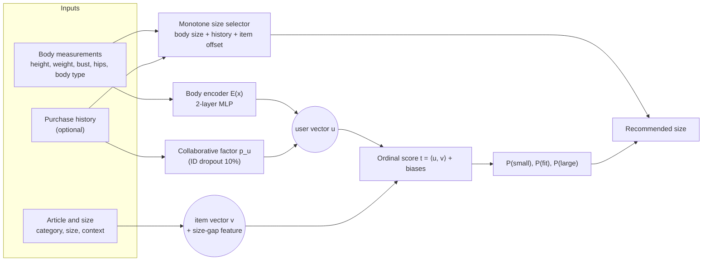
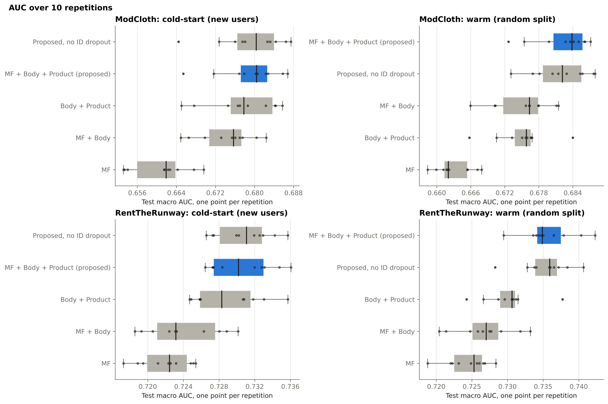
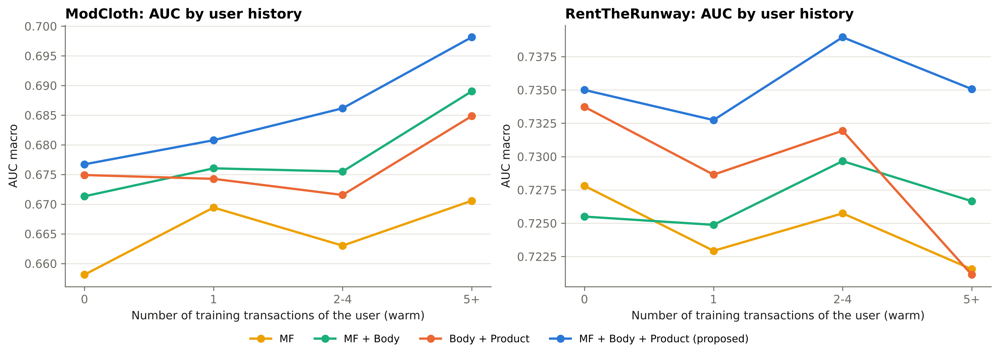

<div align="center">

# 👗 sizerec

### Overcoming Size Vanity in Online Retailing: An Intelligent Recommendation System for Apparel Fit

**Hybrid ordinal matrix factorization that turns a few self-reported body measurements into a size recommendation, from a shopper's very first visit.**

[](https://www.python.org/)
[](https://pytorch.org/)
[](LICENSE)
[](paper/sizerec-paper.pdf)
[](notebooks/sizerec_demo.ipynb)

[Paper](paper/sizerec-paper.pdf) · [Notebook](notebooks/sizerec_demo.ipynb) · [Results](results/) · [Tiếng Việt](README.vi.md)

</div>

---

## Why

Size is the number one reason clothes bought online are sent back. A size 8 at one brand is a size 10 at another, and many brands label garments smaller than they are (*size vanity*). Collaborative filtering could learn each shopper's habits, but **two thirds of shoppers in public fit datasets have exactly one purchase**, and a new shopper has none.

`sizerec` solves this cold-start problem by putting body measurements **inside** the user representation of matrix factorization: the model relies on the body when there is no history, and learns personal preferences once history exists.

## Highlights

| | ModCloth | RentTheRunway |
| --- | :---: | :---: |
| **Exact size match** vs. best-selling size | **25.5% → 51.0%** | **20.9% → 44.5%** |
| Recommendations within one size | **91.7%** | **82.3%** |
| Cold-start AUC (new users), proposed | **0.679 ± 0.007** | **0.731 ± 0.004** |
| Cold-start AUC, plain MF | 0.661 ± 0.006 | 0.722 ± 0.003 |

All numbers are mean ± std over **10 repetitions** with different data splits, with paired t-tests and paired bootstrap (200 resamples).

<p align="center">
  
</p>

## How it works



1. **Hybrid ordinal MF.** The user vector is `u = m_u · p_u + E(x_u)`: a collaborative factor (present only for known users) plus a non-linear projection of body measurements into the *same* latent space. An ordinal (cumulative-link) head turns the score into P(small), P(fit) and P(large).
2. **Product features and size gap.** Category, rental occasion and a standardised size help with rare articles; a ridge regression estimates the shopper's "natural" size so the model knows how far a size is from the body.
3. **ID dropout.** Hiding the user ID for 10% of training rows forces the body branch to work on its own, so one model serves new and returning shoppers.
4. **Monotone size selection.** Fit data are observational (petite shoppers never try size 20), so the concrete size comes from an interpretable monotone model; the fit model then reports the risk of a tight or loose fit and only suggests the neighbouring size when it is actually safer.

## Results

<p align="center">
  
</p>

<details>
<summary><b>Cold-start AUC (new users), all models</b></summary>

| Model | ModCloth | RentTheRunway |
| --- | :---: | :---: |
| `majority` | 0.500 | 0.500 |
| `body_lr` (logistic regression) | 0.585 ± 0.003 | 0.620 ± 0.004 |
| `mf` | 0.661 ± 0.006 | 0.722 ± 0.003 |
| `mf_body` | 0.674 ± 0.006 | 0.724 ± 0.004 |
| `body_product` | 0.678 ± 0.007 | 0.729 ± 0.004 |
| **`mf_body_product` (proposed)** | **0.679 ± 0.007** | **0.731 ± 0.004** |
| `mf_body_product_nodrop` (ablation) | 0.679 ± 0.007 | 0.731 ± 0.003 |

</details>

<details>
<summary><b>Warm protocol: the collaborative part pays off as history grows</b></summary>

AUC by number of past purchases of the user (mean over 10 seeds):

| Model | MC 0 | MC 1 | MC 2–4 | MC 5+ | RTR 0 | RTR 1 | RTR 2–4 | RTR 5+ |
| --- | :-: | :-: | :-: | :-: | :-: | :-: | :-: | :-: |
| `mf` | .658 | .669 | .663 | .671 | .728 | .723 | .726 | .722 |
| `body_product` | .675 | .674 | .672 | .685 | .734 | .729 | .732 | .721 |
| **proposed** | **.677** | **.681** | **.686** | **.698** | **.735** | **.733** | **.739** | **.735** |



</details>

<details>
<summary><b>Statistical significance</b></summary>


The proposed model is significantly better than `mf`, `mf_body` and `body_lr` on both datasets and both protocols. Against `body_product` it is significant everywhere except cold-start on ModCloth, where the two models share the same form (no history).

</details>

Full tables: [`results/results_summary.xlsx`](results/results_summary.xlsx) and [`results/experiment/`](results/experiment/).

## Quick start

```bash
git clone https://github.com/ngminhthotech/hybrid-size-recommender.git
cd hybrid-size-recommender
pip install -r requirements.txt && pip install -e .
```

Recommend a size for a brand-new shopper, using a pre-trained model:

```bash
sizerec recommend results/models/rtr.pt --item 126335 \
    --height 165cm --weight 57kg --bust-size 34b --body-type petite --age 22 --explain
```

Output (the CLI prints in Vietnamese; translated here):

```text
✓ Recommended size: 8 · hybrid model: P(fit) 47.2%, P(tight) 23.3%, P(loose) 29.5%
  Body-based size 6.23 + dress category +0.28 + this article runs small +0.59 → target 7.10
```

Other entry points:

| Command | What it does |
| --- | --- |
| `sizerec` | Interactive menu (asks for article, shopper type and measurements) |
| `sizerec data data/modcloth_final_data.json.gz` | Dataset statistics |
| `sizerec experiment data/<file> --quick` | One-seed sanity run in about a minute |
| `sizerec experiment data/<file> --seeds 1 2 … 10` | Full comparison with significance tests |
| `sizerec train data/<file> -o model.pt` | Train the proposed model on all data |
| `sizerec recommend model.pt --item … --json` | JSON output for integration |
| `bash scripts/run_all.sh` / `scripts\run_all.bat` | Reproduce every number and figure |

## Evaluation protocol

- **Cold-start:** users split 80/10/10, so every test user is new.
- **Warm:** transactions split 80/10/10 at random (as in Misra et al. 2018 and SFNet), with results broken down by user history.
- **No leakage:** encoders, ID maps, size regressor and item offsets are fitted on the training part of each split only; post-purchase fields (reviews, rating) are dropped; validation is used only for early stopping and threshold tuning.
- **Statistics:** 10 seeds, mean ± std, paired t-test over seeds and paired bootstrap on the test set.

## Repository layout

```text
sizerec/            Python package: data, model, trainer, experiment, sizing, recommend, CLI
tests/              Smoke test of the full pipeline on synthetic data
scripts/            run_all (.sh/.bat), quick run, demo, figure and Excel export
notebooks/          Jupyter walkthrough: EDA, quick experiment, results, boxplots, demo
data/               ModCloth and RentTheRunway (Misra et al., RecSys 2018)
results/            Per-seed metrics, summaries, significance tests, figures, logs, trained models
paper/              Paper (PDF) and LaTeX source (Springer Nature template)
```

## Datasets

ModCloth (82,790 transactions) and RentTheRunway (192,544 transactions) from the [Clothing Fit Dataset](https://cseweb.ucsd.edu/~jmcauley/datasets.html#clothing_fit) by Misra, Wan and McAuley. The data belong to their authors and are included here only for reproducibility; please cite their paper if you use them.

## Citation

```bibtex
@misc{sizerec2026,
  title  = {Overcoming Size Vanity in Online Retailing: An Intelligent Recommendation System for Apparel Fit},
  author = {Nguyen Minh Duy and Tu The Hien and Nguyen Minh Tho and Tran Anh Tuan and Nguyen Thanh Toan},
  year   = {2026},
  note   = {Nam Can Tho University},
  url    = {https://github.com/ngminhthotech/hybrid-size-recommender}
}
```

## Team

Nguyen Minh Duy · Tu The Hien · Nguyen Minh Tho · Tran Anh Tuan · Nguyen Thanh Toan

Built for the *Digital Business* course, Master of Information Technology, Nam Can Tho University, Vietnam.

## License

Code: [MIT](LICENSE). Datasets: see the original authors' terms.
