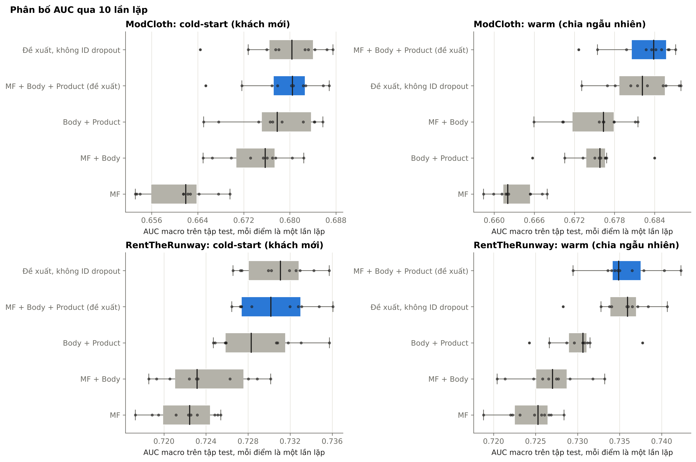

<div align="center">

# 👗 sizerec

### Khắc phục "size ảo" trong bán lẻ thời trang trực tuyến: hệ thống gợi ý size thông minh

**Mô hình phân rã ma trận lai (hybrid ordinal MF) biến vài số đo cơ thể do khách tự khai thành gợi ý size, ngay từ lần mua đầu tiên.**

[English](README.md) · [Bài báo (PDF)](paper/sizerec-paper.pdf) · [Notebook](notebooks/sizerec_demo.ipynb)

</div>

---

## Vấn đề

Size không vừa là lý do hàng đầu khiến quần áo mua online bị trả lại. Cùng nhãn size 8 nhưng mỗi hãng một kích thước, và nhiều hãng ghi size nhỏ hơn thực tế (*size vanity*). Lọc cộng tác có thể học thói quen của từng khách, nhưng **khoảng 2/3 khách trong dữ liệu chỉ mua đúng một lần**, còn khách mới thì chưa có lịch sử nào.

`sizerec` đưa số đo cơ thể **vào bên trong** vector người dùng của MF: khi chưa có lịch sử, mô hình dựa vào số đo; khi đã có lịch sử, mô hình học thêm sở thích riêng (thích mặc rộng hay ôm).

## Kết quả nổi bật

| | ModCloth | RentTheRunway |
| --- | :---: | :---: |
| Tỉ lệ gợi ý đúng size, so với size bán chạy nhất | **25,5% → 51,0%** | **20,9% → 44,5%** |
| Tỉ lệ lệch không quá 1 size | **91,7%** | **82,3%** |
| AUC với khách mới (mô hình đề xuất) | **0,679 ± 0,007** | **0,731 ± 0,004** |
| AUC với khách mới (MF thường) | 0,661 ± 0,006 | 0,722 ± 0,003 |

Trung bình ± độ lệch chuẩn qua **10 lần lặp** với các cách chia dữ liệu khác nhau, có kiểm định paired t-test và paired bootstrap.

<p align="center"></p>

## Cài đặt và chạy thử

```bash
pip install -r requirements.txt && pip install -e .
sizerec                       # menu tương tác
sizerec recommend results/models/rtr.pt --item 126335 \
    --height 165cm --weight 57kg --bust-size 34b --body-type petite --age 22 --explain
bash scripts/run_all.sh       # chạy lại toàn bộ thực nghiệm (Windows: scripts\run_all.bat)
```

## Phương pháp tóm tắt

1. **Hybrid ordinal MF:** `u = m_u·p_u + E(x_u)`, trong đó `E` là mạng MLP chiếu số đo vào cùng không gian ẩn với vector cộng tác `p_u`. Đầu ra là xác suất chật / vừa / rộng.
2. **Đặc trưng sản phẩm và khoảng cách size:** danh mục, dịp thuê, size chuẩn hoá và độ chênh giữa size đang xét với size ước lượng từ số đo.
3. **ID dropout 10%:** buộc nhánh số đo tự dự đoán tốt, nên một mô hình phục vụ được cả khách mới lẫn khách cũ.
4. **Chọn size đơn điệu, diễn giải được:** size mục tiêu = size theo số đo (trộn với lịch sử nếu có) + độ lệch danh mục + mức "chạy to/nhỏ" của sản phẩm. Mô hình hybrid sau đó báo rủi ro chật/rộng và chỉ khuyên đổi size khi size bên cạnh thật sự an toàn hơn.

## Đánh giá

- **Cold-start:** chia người dùng 80/10/10, người dùng trong tập test chưa từng xuất hiện.
- **Warm:** chia ngẫu nhiên giao dịch 80/10/10 như Misra et al. (2018) và SFNet, tách kết quả theo số lần mua trước đó.
- **Chống rò rỉ:** mọi thành phần chỉ học trên tập train của từng lần chia; bỏ các trường chỉ có sau khi mua (review, rating).

## Nhóm thực hiện

Nguyen Minh Duy · Tu The Hien · Nguyen Minh Tho · Tran Anh Tuan · Nguyen Thanh Toan

Học phần *Kinh doanh số*, Thạc sĩ Công nghệ thông tin, Trường Đại học Nam Cần Thơ.
